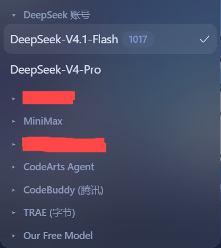
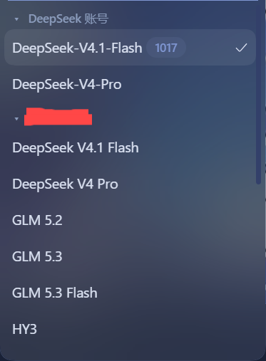

# dsh-model-group-collapse

English | [简体中文](./README.zh-CN.md)

A [DeepSeek Harness](https://github.com/deepseek-ai/deepseek-harness) (DSH) Web UI plugin that makes the **provider groups in the composer's model menu collapsible**.



## What it does

The stock model picker in the composer's tool row lists every provider group (DeepSeek Account, official endpoints, custom providers…) fully expanded. When you have many providers, the menu becomes a long wall of models.

This plugin adds a collapsible layer to that menu:

- Every provider heading becomes a **toggle with a triangle caret** (`▸` collapsed / `▾` expanded).
- **All groups start collapsed** by default.
- The **provider of the currently selected model starts expanded**.
- Click a heading to toggle that group; the caret flips and the group's models appear or disappear.
- While a **search query** is active, matched groups render expanded so results stay visible; clearing the query restores the collapse state.
- Everything else keeps working unchanged: the two-level "Model / Effort" menu, search, keyboard navigation, the pending spinner, and the official model-label badge (e.g. “1017”).



Disable the plugin in the plugin manager and the menu returns to its stock appearance immediately.

## Install

### From a local checkout (development)

1. Put this folder somewhere stable.
2. In DSH, open the plugin manager and install the bundle from the local
   directory, or use the CLI equivalent:
   `dsh plugin install /path/to/dsh-model-group-collapse`
3. Reload the Web UI and open a conversation.

### From npm (after publishing)

```bash
dsh plugin install dsh-model-group-collapse
```

### From GitHub

```bash
dsh plugin install github:LinJohn8/dsh-model-group-collapse
```

## Compatibility

- DeepSeek Harness `>=0.2.1-rc.2` (client plugin API `dsh.client`).
- Works on top of the shipped model picker: no component is replaced, so it
  follows the host's own state (streaming lock, pending selection, search
  filtering) instead of duplicating it.

## How it works

The shipped model menu renders its provider groups as
`section[data-menu-group]` elements, each with a
`[data-menu-group-heading]` label and `button[role="menuitemradio"]` rows.
The client half watches the document for that menu while it is open and
decorates each group:

- the heading gets a triangle caret and becomes a `role="button"` toggle;
- a collapsed group hides its model rows with `display:none` and reports
  `aria-expanded="false"`;
- collapse state is per group and resets on every menu open, using the
  current model's `aria-checked` row to pick the initially expanded group.

All styling is inline-scoped (`mgc-` prefix, `--dsw-alias-*` tokens), and every
DOM write is guarded by an equality check so the menu's own MutationObserver
never re-enters.

## License

[MIT](./LICENSE)
